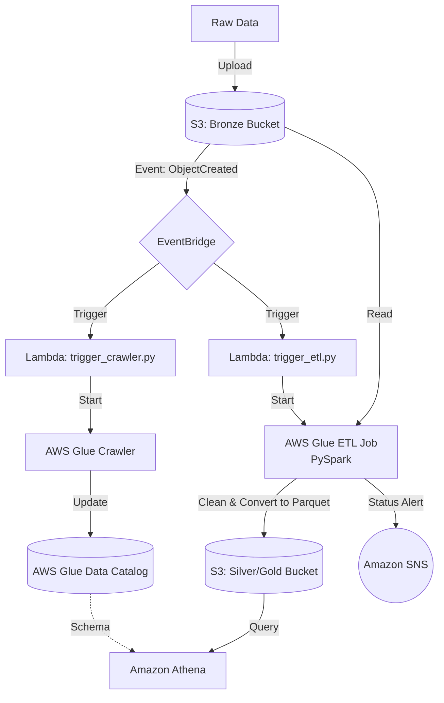

# ☁️ AWS Serverless Data Lake & Event-Driven Analytics Pipeline


This repository contains the Infrastructure as Code (IaC) and ETL scripts developed during an intensive Cloud Data Engineering program in collaboration with **Orange**. The project demonstrates a fully automated, event-driven data pipeline and a serverless data lake built entirely on the AWS ecosystem.

---

## 📌 Project Overview

The architecture is divided into two major components:

### 1. Data Lake Serverless & Analytics
- **Medallion Architecture (Amazon S3)**: Design and implementation of a multi-tier data lake (Bronze, Silver, Gold) to process and store heterogeneous data.
- **AWS Glue (PySpark)**: Development of distributed ETL jobs to clean, transform, and convert raw data into optimized Parquet format.
- **Amazon Athena**: Direct serverless SQL querying on the curated data lake via the AWS Glue Data Catalog.

### 2. Event-Driven Data Pipeline (Infrastructure as Code)
- **Terraform**: Fully automated deployment of the AWS infrastructure.
- **Amazon EventBridge**: Captures S3 `ObjectCreated` events to orchestrate the pipeline.
- **AWS Lambda**: Serverless Python functions (`trigger_crawler.py`, `trigger_etl.py`) that automatically trigger Glue Crawlers and ETL jobs.
- **Amazon SNS**: Configured to send email/SMS notifications upon successful or failed pipeline executions.

---

## 🏗️ Architecture Diagram



---

## 📂 Repository Structure

```bash
.
├── main.tf                 # Terraform configuration for S3, Lambda, EventBridge, IAM, and SNS
├── trigger_crawler.py      # AWS Lambda function to trigger the Glue Crawler
├── trigger_etl.py          # AWS Lambda function to trigger the Glue ETL job
├── glue_etl.py             # PySpark script for cleaning and converting data to Parquet
├── .gitignore              # Ignores Terraform state files and local zips
└── README.md
```

---

## 🚀 Getting Started

### Prerequisites
- **AWS CLI** configured with appropriate IAM permissions.
- **Terraform** (`>= 1.0`).

### Deployment via Terraform
1. Initialize the Terraform backend and provider:
   ```bash
   terraform init
   ```
2. Review the infrastructure plan:
   ```bash
   terraform plan
   ```
3. Deploy the resources to AWS:
   ```bash
   terraform apply -auto-approve
   ```
4. Once deployed, upload a raw CSV/JSON file to the generated Bronze S3 bucket to automatically trigger the entire pipeline (EventBridge -> Lambda -> Glue -> SNS).

---

## 🧹 Cleanup
To avoid incurring AWS charges, destroy the infrastructure when finished:
```bash
terraform destroy -auto-approve
```

---

## 📄 License
This project is licensed under the [MIT License](LICENSE) - see the LICENSE file for details.
